<p align="center">
  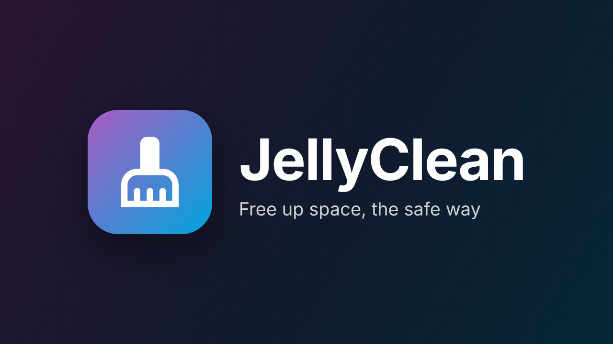
</p>

<p align="center">
  <a href="https://github.com/PeterSlijkhuis/JellyClean/releases/latest"></a>
  
  <a href="https://github.com/PeterSlijkhuis/JellyClean/actions/workflows/build.yaml"></a>
  <a href="LICENSE"></a>
</p>

<p align="center"><b>See what is in your libraries, find what nobody watches, and free up space in bulk.</b></p>

<p align="center">
  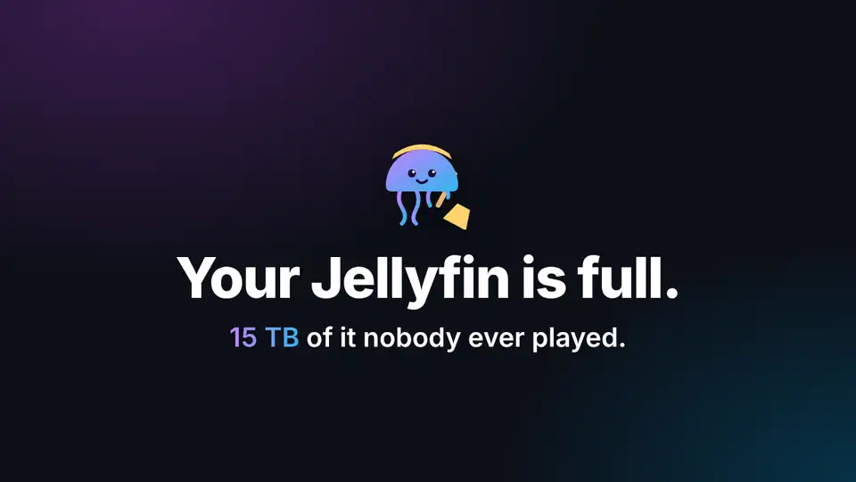
  <br /><sub>19 second tour. <a href="docs/jellyclean-demo.mp4">Download the MP4</a> (0.7 MB).</sub>
</p>

JellyClean adds a **JellyClean** page to the Jellyfin dashboard. It lists every movie, series, season and episode with when it was added, who watched it, when it was last played and how much space it takes. Filter it down, for example to *horror movies nobody played that were added over two years ago*, check the preview, and remove them all at once. Removed items are deleted from disk and from Jellyfin, and also from Radarr and Sonarr, so they are not downloaded again.

Nothing changes until you remove something. Browsing and filtering only read.

## Contents

- [Why JellyClean](#why-jellyclean)
- [Screenshots](#screenshots)
- [What you get](#what-you-get)
- [Install](#install)
- [Getting started](#getting-started)
- [How removing works](#how-removing-works)
- [Leaving soon](#leaving-soon)
- [Recycle bin and Recover](#recycle-bin-and-recover)
- [FAQ](#faq)
- [For developers](#for-developers)
- [License](#license)

## Why JellyClean

A media server fills up quietly. Radarr and Sonarr keep adding, nobody keeps removing, and one day the disk is full. Deleting by hand in Jellyfin is one item at a time with no idea what anyone watched. Automatic cleaners are fast but scary: one wrong rule and a whole library is gone.

JellyClean sits in between. It shows you the facts, lets you decide, and makes every step reversible for as long as you like.

- **It lives inside Jellyfin.** No extra container, no database, no web app on another port, no separate login. Install it from the plugin catalog and it uses Jellyfin's own users, watch history and permissions.
- **You see before anything happens.** Every removal starts with a preview that lists each file and folder, what happens in Radarr and Sonarr, and which items stay and why.
- **Safe by default.** Favorites of any user, Continue Watching, recently added, recently played, a `keep` tag, protected libraries and anything playing right now are never touched. Each favorite shows whose it is.
- **Nothing comes back by accident.** Removed movies and series leave Radarr and Sonarr (optionally on their exclusion list), so they are not downloaded again a day later.
- **Mistakes are cheap.** With the recycle bin on, files wait in a hidden folder for the days you choose. One click on **Recover** puts everything back, in Jellyfin, Radarr and Sonarr.
- **Automation that warns first.** Rules put items on a **Leaving soon** list with a notice period, optionally shown to your users as a collection, so people can save what they still want. Anything removed on its own always goes through the recycle bin.
- **Built for the whole household.** Watched status, last played and favorites are per user, so *watched by everyone* really means everyone.

### How it compares

| | JellyClean | External cleaners (Maintainerr, Janitorr and similar) | Played-item cleanup plugins (media-cleaner and similar) |
|---|---|---|---|
| Runs inside Jellyfin, nothing else to host | Yes | No, a separate service | Yes |
| Browse and filter everything by hand | Yes, with posters and per-user watch data | Usually rule-first | No, rule only |
| Preview of exactly what goes | Yes, every file | Varies | No |
| Radarr and Sonarr clean-up | Yes, several of each | Yes | No |
| Notice period before removal | Yes, Leaving soon list and collection | Often | No |
| Recycle bin with one-click recover | Yes | Rarely | No |
| Per-user favorites protect items | Yes, and shows whose favorite | Varies | Partly |

The other tools are good at what they do and you can check their own pages for details. Pick JellyClean when you want to see and decide first, keep it all inside Jellyfin, and be able to undo.

## Screenshots

**Library.** Every library at a glance: watch status by size or count, favorites, never played, quality and top genres. Hover any part for the numbers, click a part of a bar to list those items.

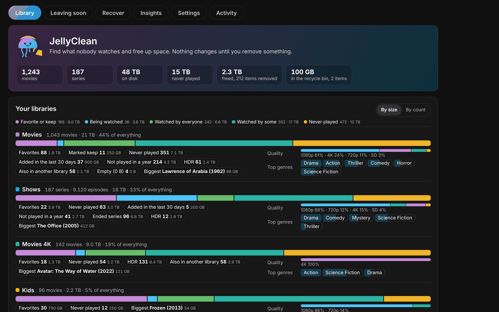

**The list.** Poster, who watched it, last played, rating, quality, copies, favorites and size. Tick what goes, or press **Free up GB**.

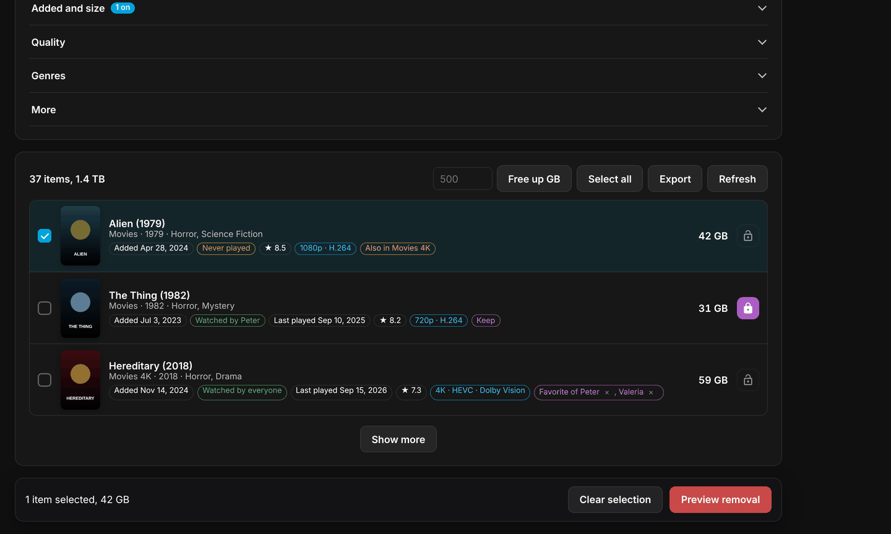

**Preview.** Exactly what is removed, what happens in Radarr and Sonarr, and what stays and why.

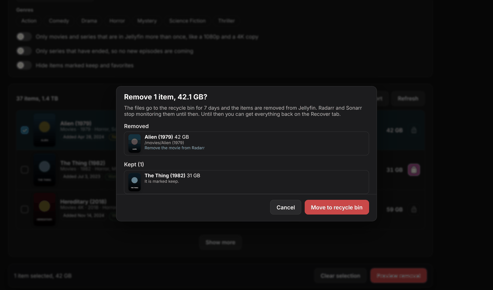

**Leaving soon.** The rules that fill it on top, then what is due now and coming up, with every detail and a **Cancel** per item.

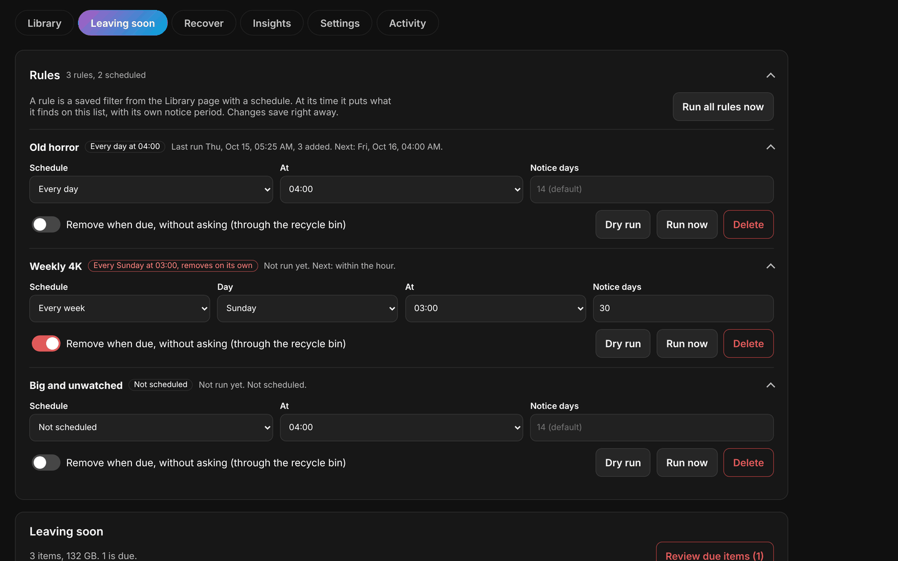
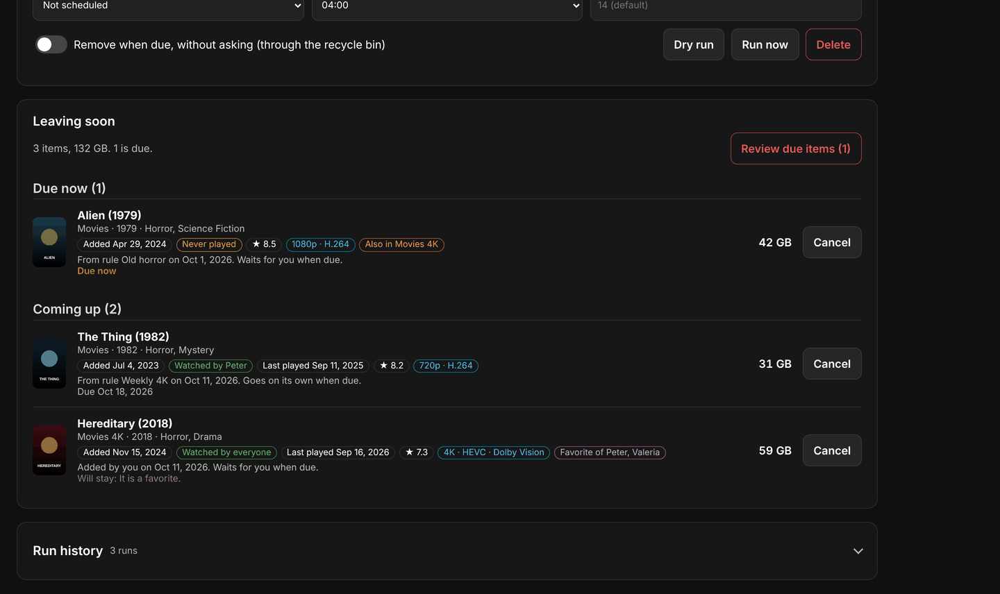

**Recover.** Everything in the recycle bin, when it is deleted for good, and a **Recover** button.

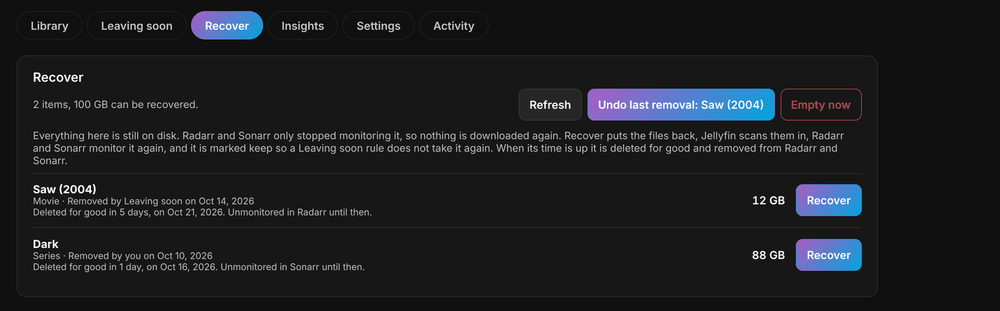

**Insights.** How full your disks are and when they fill up, fun facts, genres and how much of each nobody played, decades, quality, space hogs, hidden gems, series left halfway, how the library grew month by month and what JellyClean freed, the hours nobody has started, a hall of shame of the biggest never played titles, a side by side comparison of everyone, and a year in review per user.

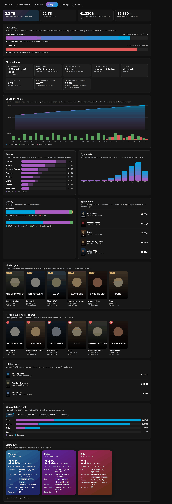

**Settings and Activity.** Safeguards, recycle bin days, Radarr and Sonarr, and a log of every removal and why something stayed.

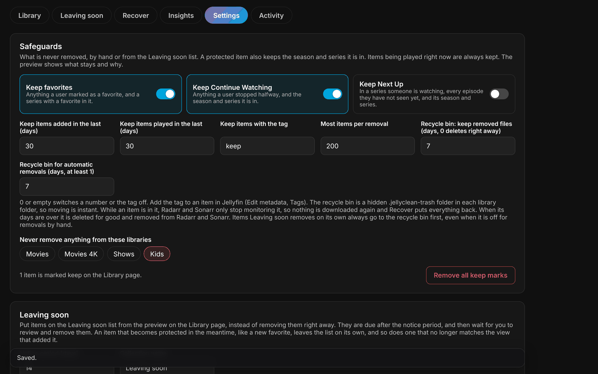
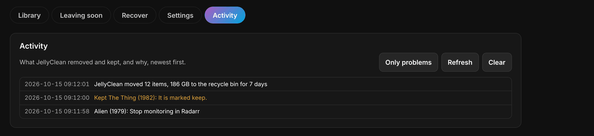

**Phone and tablet.** Every tab works on a small screen, with large touch targets.

<p align="center">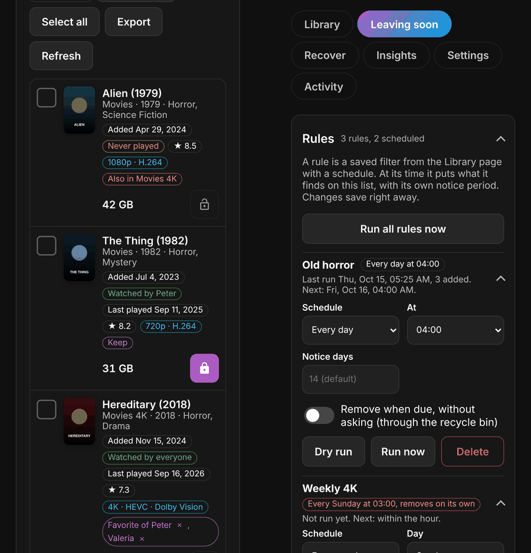</p>

## What you get

- **See what is in every library.** Each library gets a bar split by watch status: favorite or keep, being watched, watched by everyone, watched by some and never played. Switch between size and count. Hover any part for how many movies or series it is, how much space, and its share. Click a part to list exactly those items: it sets the library and the *Watch status* filter, so the list shows the same number as the bar. Under each bar: favorites, keep marks, never played, added in the last 30 days, not played in a year, ended series, HDR, copies, empty items, the biggest item, a quality split and the genres taking the most space. On a phone the details fold away under each library. JellyClean also counts how much it has freed so far, and what is waiting in the recycle bin.
- **Everything in one list.** Title, library, year, genres, date added, who watched it, when it was last played, rating, size on disk and video quality (resolution, codec and HDR).
- **Filters that add up, in groups.** Type, library, sort and search are always there; the rest sits in groups you open (Watching, Added and size, Quality, Genres, More), and a closed group shows how many of its filters are on. Type (movies, series, seasons, episodes), library, genres, watched status (unwatched, watched by someone, by everyone, or by one user), added before or after, last played (never, or over a while ago), size, resolution, codec, HDR, and search on title or path.
- **Start with what is empty.** The Library page opens on movies and series that take 0 B: usually series Sonarr added but that have no episodes yet, or whose episodes are all gone. Jellyfin only sees a download once Radarr or Sonarr moves it into the library, so anything still downloading is checked in Radarr and Sonarr and left alone. Removing them is the safest first clean-up. If a whole library folder can't be reached, like a network drive that is offline, its items are left alone, because they only look empty.
- **One-click suggestions**, folded away under *Quick filters and saved views*. *Empty movies and series*, *Never played, added over a year ago*, *Biggest movies*, *Watched by everyone*, *Finished series everyone watched*, *Series nobody played in 2 years*, *Movies you have twice* and *Old H.264 below 1080p*.
- **Free up a set amount.** Type how many GB you need and press **Free up GB**: JellyClean selects from the top of the current list, in its sort order, skipping keep, favorites and Continue Watching, until that much is selected. Then check it in the preview.
- **Finished series.** Filter on series that have ended, so no new episodes are coming. *Finished series everyone watched* finds the ones every user watched to the end.
- **Copies.** Spots movies and series that are in Jellyfin more than once, like a 1080p copy next to a 4K one. **Pick which copy to keep** under *Quick filters* lists every set with the best quality (or the smallest file) checked to stay, never moving a favorite or kept copy; change any pick, and the rest goes to the preview in one click.
- **Export.** Download the current list as a spreadsheet (CSV).
- **Real sizes.** The size is what removing frees: the movie's folder with its extras and artwork, or the episode file with its subtitles. Series and seasons add up their episodes.
- **Preview first.** See exactly which files and folders go, what happens in Radarr and Sonarr, and what stays and why. Removing 20 or more items asks you to type the number.
- **Keep what matters.** Mark anything **keep** with the lock button and it is never removed, nor the season or series it is in. Each favorite shows whose it is, and the × next to a name takes that person's favorite off, without opening the item. Safeguards you choose in **Settings** keep favorites, Continue Watching, Next Up, recently added and recently played items, items with a tag like `keep`, and whole libraries. One removal is capped at 200 items unless you change it.
- **Saved views.** Save any filter under a name and open it with one click. Days are relative, so *added over 2 years ago* still means that next year.
- **Leaving soon.** A tab of its own, with the rules on top (the whole section and each rule fold up) and the list below. Instead of deleting right away, put items on a list with a notice period (14 days by default). Users can see the list as a Jellyfin collection if you like. When items are due you review and remove them; safeguards are checked again at that moment.
- **Dry runs and run history.** **Dry run** on a rule shows what it would put on the list right now, without changing anything. *Run history* on the Leaving soon tab lists every run, dry or real, with what it matched, what it added and how much space that is.
- **Scheduled Leaving soon.** Turn any filter into a rule with **Schedule for Leaving soon**. Each rule runs every day or every week at the hour you pick, with its own notice period, and puts what it finds on the Leaving soon list. Once due, items wait for you, or are removed on their own if you switch that on for the rule.
- **Recycle bin and Recover tab.** Set a number of days under **Settings** and removed files move to a hidden `.jellyclean-trash` folder in their library folder instead of being deleted. While they are there, Radarr and Sonarr only stop monitoring them, so nothing is downloaded again. The **Recover** tab lists everything that can come back: **Recover** puts the files back, Jellyfin scans them in, Radarr and Sonarr monitor them again, and the item is marked keep so a Leaving soon rule does not take it again. Space counts as freed once the bin is emptied. When the days are over, the files are deleted for good and the movie or series is removed from Radarr and Sonarr. Whatever Leaving soon removes on its own always goes through the recycle bin (7 days by default), even when it is off for removals by hand.
- **Undo.** After a removal into the recycle bin, **Undo this removal** brings all of it back. The Recover tab has **Undo last removal** too, for the newest removal as a whole.
- **Insights tab.** How full each disk with a library is, and when it fills up at the pace of the last 12 months. A chart of space over the last 24 months, with what was added and what JellyClean freed each month. Did you know facts (how much of the space was ever played, how long it takes to watch everything at 2 hours a day, the longest movie, the oldest title, the average rating, what nobody touched in years). Genres by space with their never played part, movies and series per decade, space per resolution and codec, space hogs (the most GB per hour of film), hidden gems (the best rated titles nobody played), a hall of shame, series left halfway, *Who watches what* to compare everyone, and a year in review per user. Hover anything for the numbers.
- **Digest.** A weekly or daily update by email, to Discord, Slack or ntfy, or all of them, with the parts you pick: due now, due in the next 7 days, everything on Leaving soon, what rules added, what was added, the recycle bin, space freed, disk space and when it is full, never played, series left halfway, the biggest never played title, a hidden gem to watch and who watched the most. The email looks like JellyClean, with a card per part and an **Open JellyClean** button that opens the plugin in Jellyfin. **Preview** shows it right on the settings page, **Send a test now** sends it.
- **Radarr and Sonarr.** Removed movies leave Radarr, removed series leave Sonarr, and removed seasons or episodes stop being monitored, so new episodes still come in. Several of each are fine, like a separate 4K one.
- **Activity log.** Every removal, every item that was kept and why, and every error.

## Install

JellyClean needs **Jellyfin 12.2 or newer**. No other plugins are needed.

### Option 1: plugin repository (recommended)

1. Open **Dashboard > Plugins** and click **Manage Repositories**.
2. Click **+**, give it a name such as `JellyClean` and paste this URL:
   ```
   https://github.com/PeterSlijkhuis/JellyClean/releases/latest/download/manifest.json
   ```
3. Go back to **Plugins**, open **Available**, find **JellyClean** and click **Install**.
4. Restart Jellyfin.

### Option 2: manual install

1. Download `jellyclean_x.y.z.0.zip` from the [latest release](https://github.com/PeterSlijkhuis/JellyClean/releases/latest).
2. Unzip it into a folder called `JellyClean` inside your Jellyfin `plugins` folder. With Docker this is usually `/config/plugins/JellyClean`.
3. Restart Jellyfin.

## Getting started

1. Open **JellyClean** in the dashboard menu.
2. Under **Settings**, set **Recycle bin: keep removed files** to a few days, for example 7. Removals by hand then go to the recycle bin first and can be recovered. 0 deletes right away.
3. If you use Radarr or Sonarr, go to **Settings**, click **Add Radarr** or **Add Sonarr**, fill in the address and API key (in Radarr or Sonarr under **Settings > General**), and press **Test connection**. Settings save on their own as you change them.
4. Back on **Library**, look at the overview: click a part of a bar, like *Never played* in Movies, to list those items. Or open *Quick filters and saved views*, or set your own filters.
5. Tick what you want gone (hold Shift to tick a whole range), or press **Select all**, then **Preview removal**.
6. Check the preview and press **Delete from disk** (or **Move to recycle bin**). Press **Close, keep removing** if you don't want to wait; it carries on in the background and the bar comes back when you return.

## How removing works

For each item, in this order:

1. **Radarr or Sonarr.** A movie is removed from Radarr, a whole series from Sonarr, both with *delete files* off and optionally added to the exclusion list. For seasons and episodes, Sonarr keeps the series and only stops monitoring those episodes. Items are found by their TMDb, TVDb or IMDb id.
2. **Jellyfin and the disk.** Jellyfin's own delete removes the files, the item and its artwork, exactly like the Delete button in the Jellyfin app. With the recycle bin on, the files are moved to the bin first, Radarr and Sonarr only stop monitoring the item, and Jellyfin forgets it. If Radarr or Sonarr fails, the files go straight back and any change already made in another Radarr or Sonarr is undone. Removing the movie or series from Radarr or Sonarr waits until the bin is emptied; if that fails, the item stays in the bin and it is tried again an hour later.

If Radarr or Sonarr can't be reached, or a step there fails, that item is skipped and its files stay, because Radarr or Sonarr would only download it again. The Activity tab says why.

These always stay:

- items marked **keep**, and the seasons and series they are in;
- anything someone is playing right now;
- anything Radarr or Sonarr is downloading right now (when they are added under **Settings**).

These stay unless you switch them off under **Settings**:

- favorites of any user, and the seasons and series they are in;
- anything in someone's Continue Watching, and the season and series it is in;
- Next Up: in a series someone is watching, every episode they have not seen yet, and its season and series;
- items added in the last 30 days, and items anyone played in the last 30 days;
- items with the tag `keep` (add it in Jellyfin under **Edit metadata**);
- everything in libraries you mark as protected.

The preview lists every item that stays, with the reason.

## Leaving soon

1. In the preview, press **Leaving soon** instead of **Delete from disk**. Protected items are left off the list.
2. Optionally switch on **Show it to users as a collection** under **Settings**, so everyone sees what is leaving and can ask to keep it, or mark it a favorite.
3. The list keeps up with changes. An item that becomes protected leaves it at once when someone makes it a favorite or you mark it keep, and at the next hourly run for anything else, like someone playing it. An item a rule added that no longer matches that rule leaves too. The Activity tab says why.
4. The **Leaving soon** tab shows everything on the list with its poster and all details, grouped in *Due now* and *Coming up*, with why it is there and when it is due. **Cancel** takes one item off the list and marks it keep.
5. When the notice period is over, press **Review due items**, check the preview and remove them.

### Scheduled rules

Set a filter on the Library page and press **Schedule for Leaving soon**. It is saved as a daily rule and the **Leaving soon** tab opens. Under **Rules** every saved view has, saved as you change it:

- **Schedule**: not scheduled, every day, or every week on a day you pick;
- **At**: the hour it runs (server time);
- **Notice days**: how long its items stay on the list before they are due (empty uses the general notice period);
- **Remove when due, without asking**: off, due items wait for you; on, they are removed once due, with every safeguard checked again first.

**Run now** runs one rule straight away and the list updates on the spot; **Run all rules now** runs every scheduled one. The task **Leaving soon and recycle bin** (under **Dashboard > Scheduled Tasks**, every hour) runs the rules whose time has come, removes due items where that is on, drops items that are gone, keeps the collection up to date and empties what has been in the recycle bin long enough.

## Recycle bin and Recover

The recycle bin is what makes JellyClean forgiving.

- **Where.** Each library folder gets a hidden `.jellyclean-trash` folder with an `.ignore` file, so Jellyfin does not scan it. Moving there is instant, because it is on the same disk.
- **How long.** **Recycle bin: keep removed files** under **Settings** is for removals by hand (0 deletes right away). **Recycle bin for automatic removals** is for what Leaving soon removes on its own; it is always at least 1 day, so automation never deletes straight away.
- **Radarr and Sonarr wait.** While an item is in the bin, Radarr and Sonarr only stop monitoring it, so it is not downloaded again and nothing is lost there either. When its days are over, the files are deleted for good and the movie or series is removed from Radarr or Sonarr, added to the exclusion list if you set that.
- **Recover.** The **Recover** tab lists everything in the bin, how big it is, who or what removed it and when it is deleted for good. **Recover** moves the files back, Jellyfin scans them in, Radarr and Sonarr monitor them again and rescan, and the item is marked keep so a rule does not take it again. **Empty now** deletes everything in the bin for good.
- **Space.** Freed space is counted when the bin is emptied, because the files still take space until then.

## FAQ

**Does JellyClean change my libraries while I browse?**
No. It only reads. Its own settings and the list of items marked keep are stored in the plugin's settings, never on your items or in your media folders.

**Does it use Jellyfin's connection to Radarr and Sonarr?**
Jellyfin has no connection to Radarr or Sonarr of its own, so JellyClean needs the address and API key of each one. Add them under **Settings**. Without them, removing still works, but Radarr and Sonarr may download the items again.

**Can I skip the API keys?**
Yes. In Radarr switch on **Unmonitor Deleted Movies**, and in Sonarr **Unmonitor Deleted Episodes**, both under **Settings > Media Management**. They then stop monitoring what disappears from disk, so nothing comes back. The movie or series stays listed in Radarr or Sonarr, and an import list may still add a removed movie again; the API keys with the exclusion list prevent that.

**How do I get the digest by email with Gmail?**
Gmail does not let other programs sign in with your normal password, so you make an app password for JellyClean. Switch on [2-Step Verification](https://myaccount.google.com/signinoptions/twosv) if it is off, open [Google app passwords](https://myaccount.google.com/apppasswords), type JellyClean and press Create. Under **Settings**, *Digest*, *By email*, fill in your Gmail address and the 16 letters, and press **Send a test now**. The mail server fills itself in for Gmail, Outlook, iCloud and Yahoo. Changing your Google password deletes the app password, so make a new one then.

**Do I need the File Transformation plugin?**
No. JellyClean lives in its own dashboard page and does not change the Jellyfin web app.

**Is it safe to try?**
Yes. Browsing, filtering, saved views and the preview never change anything. Turn the recycle bin on before your first removal and even that can be undone.

**What exactly gets deleted?**
For a movie, its folder with extras, subtitles and artwork. For an episode, the episode file and its subtitles. Seasons and series remove their episodes. The preview lists every path before you confirm.

**Can it remove things on its own?**
Only if you switch on **Remove when due, without asking** for a rule. Even then every safeguard is checked again at that moment and the files go to the recycle bin first.

**Someone wants to keep something on the Leaving soon list.**
They can mark it a favorite in Jellyfin; it leaves the list at once and the Leaving soon tab shows whose favorite it is. You can also press **Cancel** on the Leaving soon tab or **keep** on the Library tab.

**Can I take away someone's favorite?**
Yes. Each favorite tag shows the names, and the × next to a name takes off only that person's favorite, without opening the item. Changes made in Jellyfin itself show up in JellyClean right away.

**I removed something by mistake.**
If the recycle bin was on, open **Recover** and press **Recover**. If it was off, the files are gone; Radarr or Sonarr can download it again once you remove it from the exclusion list and add it back.

**Does Recover give back the same item, with its watch history?**
The files go back to the same place and Jellyfin scans them in again. Jellyfin keeps watched state per item, and usually finds the item again at the same path, but this is up to Jellyfin.

**Will a series I recover come back fully monitored in Sonarr?**
JellyClean monitors again what it stopped monitoring. If Sonarr's own **Unmonitor Deleted Episodes** is on, Sonarr may have stopped monitoring episodes by itself when the files left; check the series in Sonarr after a recover.

**Does it work with several Radarr or Sonarr servers, like a 4K one?**
Yes. Add as many as you have. Each item is matched by its TMDb, TVDb or IMDb id on every server, and changes are undone on all of them if one fails.

**Does it work on a phone or tablet?**
Yes. Every tab adapts to small screens, buttons are big enough to tap, and it works with a keyboard and screen reader too.

**Does it slow down Jellyfin?**
No. It keeps a light list in memory, updates it when Jellyfin scans, and reads watch state again every few minutes. The hourly task only does work when a rule is due or something in the bin is old enough.

**Someone is halfway through a series but not in the middle of an episode. Is it safe?**
Yes, with **Keep Next Up** on (the default). When someone watched an episode of a series in the last year, every episode after the last one they watched stays, and so do its season and series. Episodes they already watched can still go. Specials don't count, like in Jellyfin's own Next Up.

**Do I need to press Save in Settings?**
No. Every change saves on its own after a moment, and the bar at the bottom says when it is saved.

**What counts as watched?**
What Jellyfin shows as watched for each user. *Never played by anyone* means nobody started it at all; a series counts as watched by a user once they watched every episode.

**Why is a series folder on disk a bit bigger than shown?**
A series adds up its episode files. Artwork and extras in the series folder are not counted.

**When do rules run?**
Every hour the task **Leaving soon and recycle bin** checks which rules are due, at the hour you picked in the server's time zone. If you use an older version and see the task running daily, set its trigger to every hour under **Dashboard > Scheduled Tasks**.

**The list is not up to date.**
When a Jellyfin scan adds or removes movies or episodes, the Library page updates on its own within about a minute. Watched state and sizes are read again every few minutes. Press **Refresh** to read everything right away.

## For developers

```bash
dotnet test JellyClean.slnx
dotnet publish Jellyfin.Plugin.JellyClean -c Release -o out
```

- Targets .NET 10 and Jellyfin 12.2.
- Filtering (`Library/Filter.cs`), the removal plan (`Library/RemovalPlan.cs`) and the Radarr and Sonarr calls (`Library/ArrClient.cs`) are covered by unit tests. No test touches a real file or server.
- **Releasing.** Open **Actions > Release > Run workflow** on `main`. Leave the version empty to count up from the last release (0.1.0 becomes 0.1.1), or fill one in. The release notes default to "Bug fixes and feature updates". It builds, tests and publishes a release with the plugin zip and `manifest.json`.

## License

JellyClean is licensed under the [GNU General Public License v3.0](LICENSE), the same as Jellyfin.
